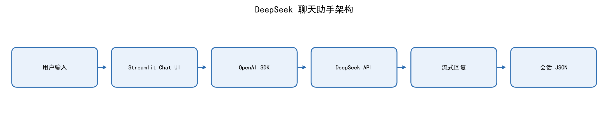

# DeepSeek 智能角色聊天助手

基于 Streamlit 和 DeepSeek API 的角色聊天应用，支持角色配置、历史会话、会话切换和流式回复。

## 目录

1. [界面预览](#界面预览)
2. [项目背景](#项目背景)
3. [核心功能](#核心功能)
4. [技术架构](#技术架构)
5. [环境要求](#环境要求)
6. [安装](#安装)
7. [配置](#配置)
8. [快速开始](#快速开始)
9. [项目结构](#项目结构)
10. [说明与限制](#说明与限制)

## 界面预览

## 项目背景

许多 LLM 对话应用只提供单轮输入框，缺少会话管理和角色配置。本项目实现一个轻量级角色聊天助手：

- 用户可以在侧边栏配置角色名称和角色描述；
- 每个会话保存为独立 JSON 文件，支持新建、加载、删除；
- 回复采用流式输出，逐字显示，提升交互体验；
- 默认使用 DeepSeek 兼容 OpenAI 的接口。

## 核心功能

| 功能 | 说明 |
| --- | --- |
| 角色配置 | 自定义角色名称、角色描述和系统提示词 |
| 会话管理 | 新建会话、历史会话列表、加载、删除 |
| 流式回复 | 通过 OpenAI Python SDK 的 stream 接口实时输出 |
| 会话持久化 | 按时间戳保存到 sessions 目录，刷新页面不丢失 |
| 轻量部署 | 一个 Streamlit 应用即可运行，无需前端构建 |

## 技术架构

应用由三层组成：

1. **Streamlit UI**：负责聊天输入、消息展示、侧边栏角色配置和历史会话列表；
2. **会话管理**：读写 sessions 目录下的 JSON 文件，每个会话独立保存；
3. **LLM 调用**：通过 OpenAI SDK 调用 DeepSeek 兼容接口，使用流式响应。

## 环境要求

- Python 3.10+
- Streamlit 1.40+
- OpenAI Python SDK 1.40+
- 可用的 DeepSeek API Key

## 安装

~~~bash
git clone https://github.com/Smasun0721/deepseek-chat-assistant.git
cd deepseek-chat-assistant
pip install -r requirements.txt
~~~

## 配置

设置环境变量 DEEPSEEK_API_KEY：

PowerShell：

~~~powershell
$env:DEEPSEEK_API_KEY = "your-api-key"
~~~

macOS / Linux：

~~~bash
export DEEPSEEK_API_KEY="your-api-key"
~~~

## 快速开始

~~~bash
streamlit run app.py
~~~

浏览器打开终端提示的地址即可使用。默认角色为“千早爱音”，可在侧边栏修改角色名称和角色描述。

## 项目结构

~~~text
deepseek-chat-assistant/
├── app.py                  # Streamlit 主程序
├── resource/logo.png       # 页面 Logo
├── reports/ui-preview.png  # 界面截图
├── docs/architecture.png   # 架构图
├── requirements.txt
├── .env.example
└── README.md
~~~

## 说明与限制

- 需要有效的 DeepSeek API Key，且账户有可用额度。
- 会话内容以明文 JSON 保存在本地 sessions 目录，请勿在公共电脑上保存敏感对话。
- 原始项目来自课程练习 PythonProject/Chapter3 的 chatAI_optimized.py，本仓库保留原有 Streamlit 代码和会话管理逻辑，仅调整项目组织方式。
- 如果部署到公网，建议增加用户认证、请求限流和内容审核。
