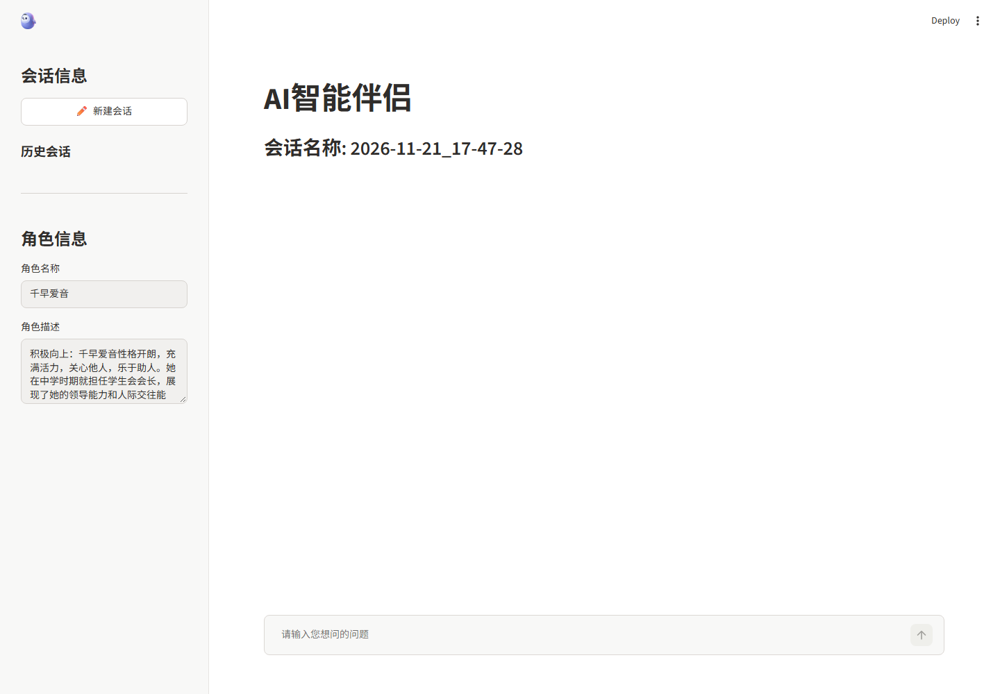

# DeepSeek 智能角色聊天助手

基于 Streamlit 和 DeepSeek API 的角色聊天应用，支持角色配置、历史会话、会话切换和流式回复。

## 界面预览

## 项目概览

| 项目信息 | 内容 |
| --- | --- |
| 应用类型 | Streamlit 单页聊天应用 |
| 模型接口 | DeepSeek OpenAI 兼容接口 |
| 会话存储 | sessions/*.json |
| 默认模型 | deepseek-v4-pro |
| 启动方式 | streamlit run app.py |

## 目录

1. [项目背景](#项目背景)
2. [核心功能](#核心功能)
3. [使用流程](#使用流程)
4. [技术架构](#技术架构)
5. [会话存储格式](#会话存储格式)
6. [环境要求](#环境要求)
7. [安装](#安装)
8. [配置](#配置)
9. [快速开始](#快速开始)
10. [项目结构](#项目结构)
11. [安全与限制](#安全与限制)
12. [常见问题](#常见问题)

## 项目背景

许多 LLM 对话应用只提供单轮输入框，缺少会话管理和角色配置。本项目实现一个轻量级角色聊天助手：

- 用户可以在侧边栏配置角色名称和角色描述；
- 每个会话保存为独立 JSON 文件，支持新建、加载、删除；
- 回复采用流式输出，逐字显示，提升交互体验；
- 默认使用 DeepSeek 兼容 OpenAI 的接口。

## 核心功能

| 功能 | 说明 |
| --- | --- |
| 角色配置 | 自定义角色名称、角色描述和系统提示词 |
| 会话管理 | 新建会话、历史会话列表、加载、删除 |
| 流式回复 | 通过 OpenAI Python SDK 的 stream 接口实时输出 |
| 会话持久化 | 按时间戳保存到 sessions 目录，刷新页面不丢失 |
| 轻量部署 | 一个 Streamlit 应用即可运行，无需前端构建 |

## 使用流程

1. 启动应用，进入默认会话；
2. 在侧边栏填写角色名称和角色描述；
3. 在底部输入问题并发送；
4. 助手通过 DeepSeek 接口流式返回回复；
5. 需要切换话题时点击“新建会话”；
6. 历史会话可以从侧边栏重新加载或删除。

## 技术架构

应用由三层组成：

1. **Streamlit UI**：负责聊天输入、消息展示、侧边栏角色配置和历史会话列表；
2. **会话管理**：读写 sessions 目录下的 JSON 文件，每个会话独立保存；
3. **LLM 调用**：通过 OpenAI SDK 调用 DeepSeek 兼容接口，使用流式响应。

发送消息时，系统提示词由角色名称和角色描述拼接，和当前会话历史一起发送给模型；模型回复以流式 chunk 形式逐段写入页面。

## 会话存储格式

每个会话保存为 sessions/{session_name}.json，结构如下：

~~~json
{
  "session_current": "2026-11-21_19-00-00",
  "name": "角色名称",
  "scription": "角色描述和系统提示词",
  "message": [
    {"role": "user", "content": "用户消息"},
    {"role": "assistant", "content": "助手回复"}
  ]
}
~~~

会话文件按时间戳倒序显示，加载时恢复角色信息和完整对话。

## 环境要求

- Python 3.10+
- Streamlit 1.40+
- OpenAI Python SDK 1.40+
- 可用的 DeepSeek API Key

## 安装

~~~bash
git clone https://github.com/Smasun0721/deepseek-chat-assistant.git
cd deepseek-chat-assistant
pip install -r requirements.txt
~~~

## 配置

设置环境变量 DEEPSEEK_API_KEY：

PowerShell：

~~~powershell
$env:DEEPSEEK_API_KEY = "your-api-key"
~~~

macOS / Linux：

~~~bash
export DEEPSEEK_API_KEY="your-api-key"
~~~

## 快速开始

~~~bash
streamlit run app.py
~~~

浏览器打开终端提示的地址即可使用。默认角色为“千早爱音”，可在侧边栏修改角色名称和角色描述。

## 项目结构

~~~text
deepseek-chat-assistant/
├── app.py                  # Streamlit 主程序
├── resource/logo.png       # 页面 Logo
├── reports/ui-preview.png  # 界面截图
├── docs/architecture.png   # 架构图
├── requirements.txt
├── .env.example
└── README.md
~~~

## 安全与限制

- 需要有效的 DeepSeek API Key，且账户有可用额度。
- 会话内容以明文 JSON 保存在本地 sessions 目录，请勿在公共电脑上保存敏感对话。
- 原始项目来自课程练习 PythonProject/Chapter3 的 chatAI_optimized.py，本仓库保留原有 Streamlit 代码和会话管理逻辑，仅调整项目组织方式。
- 如果部署到公网，建议增加用户认证、请求限流和内容审核。
- 如果模型接口超时，检查网络、API Key 和 DeepSeek 服务状态。

## 常见问题

**Q：启动后提示 DEEPSEEK_API_KEY 未设置？**  
按“配置”章节设置环境变量，重新启动应用。

**Q：聊天回复很慢？**  
流式输出依赖模型服务响应，检查网络和 API 余额；也可以在代码中调整模型参数。

**Q：历史会话在哪里？**  
项目根目录的 sessions 目录，每个会话一个 JSON 文件。

**Q：可以换成其他模型吗？**  
可以，修改 app.py 中的 model 和 base_url 即可接入兼容 OpenAI 协议的服务。
